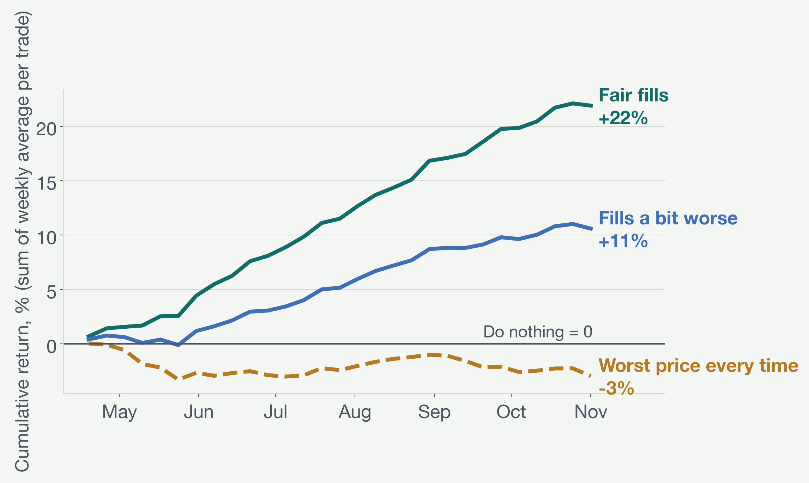

# Weekend Fade: an automated paper-trading agent for 24/7 stock perps

**Agentverse 2026, Finance Track. Gower Street Capital.**

US stock perpetuals on Hyperliquid (the trade[XYZ] markets) trade all weekend, but the stock market doesn't. From Friday
20:00 to Sunday 20:05 ET each stock perp is priced only from its own thin order book, so single stocks drift away from the
rest of the market. At 20:05 ET on Sunday the perps switch back to real prices (Blue Ocean ATS overnight trading) and part
of the drift is corrected. **On average 39% of a stock's weekend gap vs the Nasdaq-100 comes back. On weeknights, 0%.**

The system fades those gaps, hedged against the Nasdaq-100 perp, fully automatically:

| Part | What it does | Deterministic? |
|---|---|---|
| **Quant engine** (`signals.py`, `risk.py`, `config.py`) | Measures each stock's gap vs the index since Friday's close, applies the trigger, sizes, beta-hedges, enforces risk limits, manages exits | Yes: pure, unit-tested functions |
| **News agent** (`news.py`, `sentiment_agent.py`) | Fetches the weekend's headlines for each candidate and asks Gemini one narrow question: does stock-specific news explain this move? | The model answers; a **fixed rule** decides (skip if news explains it with confidence ≥ 0.6) |
| **Orchestrator** (`agent.py`) | Sun 17:00 scan → news check → 19:00 paper entry against live order books → hourly take-profit checks → Mon 04:00 exit. Logs every step. Kill switch. | Yes |

**Who it's for:** a trader who believes "weekend crypto-venue stock prices overshoot" and wants that tested and run with
discipline: every decision traced from raw prices to output, real news separated from noise, and hard limits in code.

**Paper trading only.** There is no wallet, signing or order code in this repository; it only reads public data.

## Quick start

```bash
cd weekend_fade && uv sync && cd ..                                   # Python 3.12
echo "GEMINI_API_KEY=..." > weekend_fade/.env                          # for the news agent (git-ignored; without it the agent fails safe and skips every trade)
weekend_fade/.venv/bin/python -m pytest weekend_fade/tests -q          # 16 tests
weekend_fade/.venv/bin/python -m weekend_fade.agent scan               # measure gaps now, news check, queue trades
weekend_fade/.venv/bin/python -m weekend_fade.agent autopilot          # run tonight unattended: 17:00 / 19:00 / hourly / 04:00 ET
weekend_fade/.venv/bin/python -m weekend_fade.agent halt               # kill switch (halt --off to clear)
weekend_fade/.venv/bin/python -m weekend_fade.agent status             # recent decisions
```

Reproduce the evidence. The exact hourly candles used (Hyperliquid public data, 14 Apr – 8 Nov 2026) are committed in
`weekend_fade/data/`, because Hyperliquid only serves the most recent ~5,000 hours: re-downloading later gives a shifted window.

```bash
weekend_fade/.venv/bin/python -m weekend_fade.final_backtest           # headline table: v1 vs v2, with/without news, three fill assumptions
weekend_fade/.venv/bin/python -m weekend_fade.pitch_charts             # charts + example trades + t-tests (results/charts/)
weekend_fade/.venv/bin/python -m weekend_fade.portfolio_sharpe         # dollar-book Sharpe with CI, deflated Sharpe, drawdown
weekend_fade/.venv/bin/python -m weekend_fade.backtest                 # rule v1 + baselines + placebo (add --fetch to download a fresh window)
weekend_fade/.venv/bin/python -m weekend_fade.analysis                 # statistical tests behind the explainer
weekend_fade/.venv/bin/python -m weekend_fade.rule_research            # 216 entry/exit/hedge/sizing variants, train/test
weekend_fade/.venv/bin/python -m weekend_fade.news_backtest            # news filter on all 254 past trades (~7 min)
weekend_fade/.venv/bin/python -m weekend_fade.news_leakage_check       # can the model 'remember' the future? (blinded rerun)
```

(`news_backtest` and `news_leakage_check` call Google News and Gemini again; their saved outputs are in `results/`.)

## The trading rule (v2)

1. **Gap** = stock perp move − Nasdaq-100 perp move, Friday 16:00 → Sunday 17:00 ET (log returns, basis points).
2. **Trigger:** |gap| ≥ 0.50% for big names (NVDA, TSLA, AAPL, MSFT, META, AMZN, GOOGL, AVGO, NFLX), ≥ 1.50% for other stocks;
   gaps ≥ 8% are left alone (probably real news). Stocks with no Blue Ocean overnight price are excluded.
3. **Risk limits:** size = min($50k big / $10k other, 10% of last-hour volume). Veto if volume < $5k/hr, last trade > 90 min
   old, book impact > 25bp, > 3 trades on one side of one sector, or gross exposure > $250k.
4. **News filter:** skip if weekend news explains the move in the same direction (confidence ≥ 0.6). No headlines → trade.
5. **Enter Sunday 19:00 ET:** short the stock if it ran ahead (long if it lagged), hedged with **beta ×** the dollars in the index perp.
6. **Exit:** once half the gap has been recovered (checked hourly, executed at the next check), otherwise Monday 04:00 ET.

Example decision from the live log (8 Nov 2026):
`AVGO moved +76bp since Friday's close, the Nasdaq-100 perp -8bp, so AVGO is +85bp ahead of the market (trigger 50bp)...`
→ news agent: *no relevant news (confidence 0.85)* → short $4,723 AVGO, long 1.57 × $4,723 of the index perp at 19:00 ET.

## Evidence

29 weekends, 58 US stock perps, Apr–Nov 2026, Hyperliquid 1h candles. Costs: real fees (0.9bp growth-mode or 9bp per side),
spread, index slippage. Hyperliquid has no historical order books, so three fill assumptions bracket the real cost.
Full table: `weekend_fade/results/final_comparison.csv`.

| Rule | Fills | Trades | Avg / trade | Win rate | t (by weekend) | Sharpe (per-trade avg) | Weekends + |
|---|---|---|---|---|---|---|---|
| v1: Sun 18:00, 1:1, exit 04:00 | fair | 254 | +0.76% | 68% | 4.1 | 5.5 | 23/29 |
| **v2 + news filter** | **fair** | **211** | **+0.82%** | **77%** | **8.0** | **10.7** | **28/29** |
| **v2 + news filter** | **a bit worse** (25% of the hour's range) | **211** | **+0.43%** | **65%** | **4.4** | **5.9** | **23/29** |
| v2 + news filter | worst price of the hour | 211 | −0.05% | 54% | −1.2 | −1.6 | 15/29 |

**Portfolio Sharpe** (`portfolio_sharpe.py`): the Sharpe column above uses average returns per trade and ignores sizes. With real
dollar positions and every live limit applied (153 trades, average position $9.3k, average gross $121k), weekly dollar P&L gives
an annualised Sharpe of **5.9 (95% CI 3.5–8.3)** at fair fills, 3.0 (0.0–6.0) with slightly worse fills and −1.8 at the worst price.
Deflated Sharpe probability for the 216 variants tried: 0.98 at fair fills, 0.43 with slightly worse fills. Max drawdown −$389 (fair).



**Why we believe it is real** (rule v2 + news filter, fair fills, unless stated)
- **Unseen data:** rule v2 was chosen from 216 variants using only the first 14 weekends (to 19 Jul). On the 15 later weekends
  it never saw: +0.77% per trade, t 5.3 (p 0.0001), 14 of 15 weekends positive (`results/charts/out_of_sample.png`).
- **Placebo:** the same measurement on weeknights, when perps follow real prices, shows nothing (slope t +0.8; strategy −0.08%, t −0.5).
  The weekend-minus-weeknight slope difference has t −3.8.
- **Mechanism timing:** most of the gain arrives in the hour of the 20:05 ET switch to real prices.
- **Robustness:** none of 100,000 random sign flips of the weekly results beat it; bootstrap 95% interval of the mean +0.57% to
  +0.94% per trade; dropping any one weekend leaves t ≥ 7.7, dropping the best three t 7.9; works in the 9 big names alone
  (t 2.9) and in the other stocks (t 7.9). Betting the other way (momentum) loses (−0.98% per weekend, t −5.6).
- **News filter:** kept trades +0.82% vs skipped +0.25% (Welch p 0.04; skipping 43 random trades does this well only 0.9% of
  the time); holds in both halves. Trades with no weekend headlines at all revert most (+1.06%).
- **No look-ahead in the news test:** all 502 headlines are timestamped Fri 16:00–Sun 17:00 ET; prompts contain no dates and
  no prices after Sun 17:00; the model's training cutoff is March 2026 and it answered "unknown" to every outcome question;
  a blinded rerun with company names removed made the same call 96% of the time and filtered as well.

**Two example trades** (backtest, `results/charts/numbers.json`)
- **Traded, NVDA, weekend of 12 Jul 2026:** NVDA +0.71% ahead of the Nasdaq-100 at Sunday 17:00. Three headlines, judged
  "recap/opinion, no fresh news" → short $50k NVDA, long $55k index perp (beta 1.10) at 19:00; half the gap recovered by 21:00,
  exited 22:00: **+0.99% = +$493** after costs (`results/charts/trade_win.png`).
- **Skipped by the news agent, NBIS, weekend of 14 Jun 2026:** NBIS +2.56% ahead. Saturday headline *"Nebius Joins Nasdaq-100
  As AI Infrastructure Growth Meets Index Flows"* → explained by news, confidence 0.9 → no trade. Fading it would have lost
  **2.21% (−$221 on $10k)**; it kept rising after real prices returned (`results/charts/trade_skip.png`).

`results/BACKTEST.md`, `backtest.json`, `equity.png`, `weekend_trades.csv` and the explainer page describe rule v1 (the
original rule, kept as the baseline); everything else describes v2.

## Limits

- **Execution decides it.** At the worst price of the hour the edge is gone. The forward test (`docs/FORWARD_TEST.md`) measures real order-book fills.
- **Small.** Volume-capped sizes average about $14k per trade: hundreds of dollars a week of paper P&L, not thousands.
- **In-sample period of 29 weekends.** The earlier Nov 2025–Apr 2026 period (4-hour data only) points the same way but much more weakly.
- **Historical news** is searched today, so its ranking may differ slightly from what was visible live; the live agent fetches news in real time.
- **Venue risk.** trade[XYZ] changed its weekend pricing rules in April and August 2026; a further change could remove the effect.

## Data and licences

- **Hyperliquid public info API:** candles, live order books, market metadata (trade[XYZ] markets). Public market data, no key.
  A snapshot of the hourly candles is committed in `weekend_fade/data/` for reproducibility.
- **Google News RSS search:** weekend headlines (titles, sources, timestamps only).
- **Google Gemini API** (`gemini-3.5-flash-lite`): news judgements; requires your own key.

The visual explainer of the strategy is in `weekend_fade/explainer/weekend-fade-explainer.html` (rule v1 statistics).
